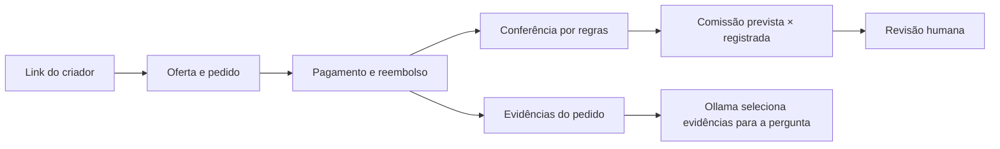

# YouShop Sentinel AI

**Uma venda de R$ 100,00 foi reembolsada por inteiro. Por que ainda aparecem R$ 10,00 de comissão para o criador?**

O Sentinel abre o pedido, recupera os registros e compara a comissão prevista pela oferta fictícia com o valor lançado. Quem revisa pode seguir cada etapa, perguntar qual evento comprova o reembolso e registrar um parecer. Tudo roda no computador com dados sintéticos.

[Instalar no Windows](#instalar-no-windows) · [Confirmar a IA](#confirmar-a-ia) · [Experimentar o painel](#experimentar-o-painel) · [Resolver problemas](#resolver-problemas)



## Instalar no Windows

Para reproduzir a **demonstração com IA**, você precisa de **Python 3.12**, do aplicativo **Ollama** em execução e do modelo **`qwen3:4b`** instalado. O repositório já traz a interface compilada. O download inicial exige internet. Depois de instalar as dependências e o modelo, a demonstração usa serviços locais.

### 1. Baixe o projeto e prepare o Python

Na página do repositório, escolha **Code → Download ZIP**, extraia o arquivo e abra a pasta que contém `pyproject.toml`. No Explorador de Arquivos, digite `powershell` na barra de endereço e pressione Enter. Se você usa Git, também pode clonar o repositório e abrir essa mesma pasta.

Instale o Python 3.12 com o inicializador do Windows. [Python 3.12 para Windows](https://www.python.org/downloads/release/python-31210/)

No PowerShell, confira a versão e prepare o projeto. O último comando carrega os eventos de exemplo no banco local. Ele pode ser repetido.

```powershell
py -3.12 --version
py -3.12 -m venv .venv
.\.venv\Scripts\python.exe -m pip install -e ".[dev]"
.\.venv\Scripts\python.exe -m sentinel.data
```

### 2. Instale o Ollama e baixe o modelo

Baixe o instalador oficial para Windows, execute-o e abra **Ollama** pelo menu Iniciar. Ele roda em segundo plano. Abra um **novo PowerShell** para que o Windows reconheça o comando instalado. [Baixar Ollama](https://ollama.com/download/windows) · [Guia oficial para Windows](https://docs.ollama.com/windows)

```powershell
ollama --version
ollama pull qwen3:4b
ollama list
```

Espere o download terminar. A lista deve conter **`qwen3:4b`**. O modelo ocupa cerca de **2,5 GB**, além do espaço usado pelo aplicativo. O nome `sentinel-qwen-local` que aparece em avaliações antigas identifica um modelo personalizado usado no desenvolvimento. Para seguir este guia, use `qwen3:4b` nos dois comandos de configuração e download. [Modelo no catálogo oficial](https://ollama.com/library/qwen3:4b)

### 3. Ligue o painel com a IA

Volte ao PowerShell aberto **na pasta do projeto**. Execute as três linhas no mesmo terminal. As duas primeiras dizem ao Sentinel para consultar o Ollama e qual modelo usar. A terceira inicia o painel.

```powershell
$env:SENTINEL_LOCAL_AI = "1"
$env:SENTINEL_OLLAMA_MODEL = "qwen3:4b"
.\.venv\Scripts\python.exe -m uvicorn sentinel.main:app --host 127.0.0.1 --port 8001
```

Abra o [painel no navegador](http://127.0.0.1:8001/). Mantenha o terminal aberto. Para encerrar o painel, pressione **Ctrl+C**. Em uma sessão nova, repita as três linhas desta etapa. O modelo baixado permanece instalado.

<details>
<summary>Quero experimentar primeiro só com os registros do pedido</summary>

Depois da etapa 1, defina `$env:SENTINEL_LOCAL_AI = "0"` e execute o comando do servidor da etapa 3. A conferência, o histórico, os gráficos e a revisão humana funcionam nesse modo. Para ligar a seleção de evidências por IA depois, conclua a etapa 2 e reinicie o painel seguindo a etapa 3.

</details>

## Confirmar a IA

1. Em **Resumo da operação**, clique em **Conferir este pedido** no caso dos R$ 10,00.
2. Abra **Perguntar sobre o pedido**. Digite **Qual evento comprova o reembolso?** e clique em **Consultar**. A primeira consulta pode levar mais tempo enquanto o modelo carrega.
3. Confira o evento **`lab-comissao-apos-reembolso-1`** e o valor de **R$ 100,00**. Quando o modelo seleciona essa evidência, a tela mostra **Seleção de evidências por IA · qwen3:4b**.

A mesma pergunta pode receber uma resposta pelos registros locais se o modelo estiver indisponível. Algumas consultas, como totais e decisões humanas, são atendidas diretamente pelo código. **Para verificar a participação do modelo nessa consulta, procure a indicação de seleção por IA.**

<details>
<summary>Verificar a resposta do servidor pelo PowerShell</summary>

Com o painel aberto, execute em outro terminal:

```powershell
$pergunta = @{ question = "Qual evento comprova o reembolso?" } | ConvertTo-Json
$resposta = Invoke-RestMethod -Method Post `
  -Uri "http://127.0.0.1:8001/api/orders/lab-comissao-apos-reembolso/explanation" `
  -ContentType "application/json; charset=utf-8" -Body $pergunta
$resposta | Select-Object model, generation_status, citation_ids
```

`model = qwen3:4b` e `generation_status = selected` confirmam a seleção pelo modelo. Em `citation_ids` aparece o identificador que você pode conferir no histórico.

</details>

## Experimentar o painel

| Onde clicar | O que investigar |
| --- | --- |
| **Resumo da operação** | Abra o caso guiado ou explore os gráficos por criador e período. A carteira reproduz 10.000 pedidos, 500 criadores, 100 produtos e 90 dias fictícios. |
| **Conferir pedido** | Compare venda, reembolso, comissão prevista e registrada. Em **Rastrear a origem dos registros**, clique em **Pagamento**, **Reembolso** e **Comissão**. No caso guiado, a diferença de R$ 10,00 pede revisão humana. |
| **Comissões por criador** | Escolha um perfil fictício, filtre o extrato por situação do repasse e abra o pedido para consultar o histórico. Para ver um agendamento, escolha **Criador 177**, filtre **Repasse agendado** e abra **sim-00176**. |
| **Testar cenários** | Execute uma rodada e compare **Esperado** com **Observado**. A seleção com IA pode variar. No caso `sim-00004`, a comissão de R$ 3,04 confere, mas a oferta venceu antes da venda e falta a confirmação independente. A regra inicial deixou esse caso passar. |
| **Avaliar regras** | Examine as verificações sugeridas a partir de 25 pedidos. Uma pessoa pode aprovar a repetição em outros 25 reservados. No teste reproduzível, os problemas sem alerta passaram de 10 para 0 e os três pedidos regulares continuaram liberados. |
| **Guia do Sentinel** | Consulte o significado de comissão prevista, atribuição, alerta indevido e outras expressões usadas na interface. |

**Quem decide o quê?** O código calcula dinheiro em centavos. O Ollama seleciona evidências e pode ajudar a escolher cenários de um catálogo autorizado. A pessoa registra a decisão sobre o alerta e autoriza ou rejeita novos testes. Os pareceres ficam no banco SQLite daquela instalação.

**Como ler o repasse.** A carteira de 10.000 pedidos tem um calendário fictício com fechamento em **31/03/2026**. Para vendas regulares, o exemplo agenda a transferência três dias após a venda e registra a conclusão sete dias após a venda, se essa data já chegou no calendário simulado. Pendência financeira, confirmação ausente ou oferta vencida deixam a comissão retida. Os pedidos de referência antigos que não têm histórico de repasse continuam sem uma data disponível. Em cada pedido, a resposta se refere somente à comissão daquela venda.

**Investigar vendas relacionadas.** Abra **sim-00176** pelo extrato do **Criador 177**. Em **Pedidos relacionados**, escolha **Mesmo criador** para encontrar as outras 19 vendas vinculadas a `creator-177`. Troque para **Mesma oferta** para comparar vendas de outros criadores que divulgaram aquela oferta. Em **Mesmo link**, este exemplo fica vazio porque nenhuma outra venda usou aquele link. Clique em um pedido da lista para investigar seus próprios registros e use **Voltar** para retornar ao pedido inicial. Cada comparação usa o identificador exato dentro da carteira simulada ou do conjunto de casos de referência. O vínculo, por si só, não gera alerta.

## Resolver problemas

<details>
<summary>O Windows não reconhece py ou ollama</summary>

Para `py`, confira se o Python 3.12 e o inicializador do Windows foram instalados. Para `ollama`, conclua o instalador e abra um novo PowerShell. Confirme com `py -3.12 --version` ou `ollama --version` antes de continuar.

</details>

<details>
<summary>O painel abre, mas a consulta não mostra a indicação de IA</summary>

1. Abra o Ollama pelo menu Iniciar. Em outro terminal, execute `(Invoke-RestMethod http://127.0.0.1:11434/api/tags).models.name`. A porta **11434** pertence ao Ollama.
2. Se `qwen3:4b` estiver ausente, execute `ollama pull qwen3:4b`.
3. No terminal do Sentinel, encerre o servidor com **Ctrl+C** e repita a etapa 3 com as duas variáveis. Alterar as variáveis em outro terminal não reconfigura o processo já aberto.
4. Repita a pergunta de verificação no exemplo de reembolso integral. Um pedido sem reembolso terá outra resposta.

</details>

<details>
<summary>A porta do painel já está em uso</summary>

Escolha outra porta, por exemplo `--port 8002`, no comando do servidor e abra `http://127.0.0.1:8002/`. Use a mesma porta na verificação por PowerShell. O endereço `127.0.0.1` sempre aponta para o computador da pessoa que está executando o projeto.

</details>

## Testes e evidências

Na pasta do projeto, rode a suíte automatizada e a avaliação das sete perguntas sintéticas. A terceira linha inclui os modelos disponíveis no Ollama e pode demorar mais.

```powershell
.\.venv\Scripts\python.exe -m pytest -q
.\.venv\Scripts\python.exe -m evaluation.retrieval
.\.venv\Scripts\python.exe -m evaluation.retrieval --live
```

As métricas descrevem cenários com gabarito conhecido. As regras de comissão e os valores são fictícios. Os materiais públicos servem de referência para o fluxo investigado. [Origem dos dados](docs/provenance.md) · [Pesquisa do problema](docs/discovery.md) · [Guia técnico](docs/trustgraph.md) · [Avaliação registrada dos modelos](evaluation/retrieval-v2.json) · [Roteiro do projeto](docs/delivery.md)
